# Sistema de Gestión Bibliotecaria — SGB

Sistema de Gestión Bibliotecaria para la Universidad de Madeira, desarrollado con una **arquitectura por capas (N-Tier)** como proyecto académico de la asignatura Desarrollo de Software II.

## Información académica

- **Estudiante:** Manuel Morales Martínez
- **Código:** 406384
- **Institución:** Fundación Universitaria Católica Lumen Gentium — UNICATÓLICA
- **Asignatura:** Desarrollo de Software II
- **Evaluación:** Segundo Momento Evaluativo
- **Docente:** Fabian Stiven Valencia Córdoba

## Descripción del proyecto

El frontend es la capa de presentación del Sistema de Gestión Bibliotecaria. Está desarrollado con React, TypeScript, Vite y Tailwind CSS. Ofrece un portal de demostración, una experiencia de estudiante y un espacio de gestión bibliotecaria.

La interfaz consume la API REST del backend mediante solicitudes HTTP y utiliza respuestas JSON para mostrar y actualizar la información. El HTML de la aplicación lo sirve el frontend; la API devuelve datos y no páginas HTML.

El sistema de demostración incluye catálogo de recursos, usuarios de ejemplo, préstamos, reservas, renovaciones, devoluciones, multas y actividades con inscripción.

## Arquitectura por capas (N-Tier)

La separación por capas delimita responsabilidades, reduce el acoplamiento y facilita el mantenimiento, las pruebas y la evolución del sistema. Se basa en el patrón descrito en *Fundamentals of Software Architecture*, de Mark Richards y Neal Ford: cada capa mantiene una responsabilidad definida y se comunica con las capas adyacentes.

1. **Presentación — frontend y API:** la interfaz React presenta la información. En el backend, Express y los controladores reciben solicitudes HTTP y generan respuestas.
2. **Lógica de aplicación — servicios:** coordina los casos de uso y las reglas del dominio.
3. **Persistencia — repositorios:** encapsula las consultas SQL y el acceso a los datos.
4. **Base de datos — Supabase PostgreSQL:** almacena recursos, usuarios, préstamos, reservas, multas y actividades.

Esta división permite cambiar la interfaz sin trasladar las consultas SQL, y modificar la persistencia sin llevar esa lógica a los controladores.

## Flujo end-to-end: consulta de recursos

1. El frontend solicita `GET /api/recursos` vía HTTP.
2. Express dirige la solicitud al controlador de recursos.
3. El controlador delega la operación a `recursoService`.
4. El servicio solicita los registros a `recursoRepository`.
5. El repositorio consulta PostgreSQL mediante el pooler de Supabase.
6. Los registros regresan del repositorio al servicio y al controlador.
7. El controlador responde con **`200 OK`** y un JSON estandarizado. La API devuelve datos, no HTML.

Ejemplo de respuesta:

```json
{
  "success": true,
  "data": [
    {
      "id": 1,
      "titulo": "Ejemplo de recurso",
      "autor": "Autor de ejemplo",
      "coleccion": "General",
      "ejemplares": 2,
      "estado": "Disponible"
    }
  ]
}
```

## Diagrama de arquitectura

[Abrir el editor Mermaid Live](https://mermaid.live/) · [Ver el diagrama compartido](https://mermaid.ai/d/16789ce8-6554-427d-917e-ce4389f31fb5)

El siguiente diagrama documenta la arquitectura implementada: presentación, proxy HTTP, rutas y controladores, servicios, repositorios, transacciones, tablas PostgreSQL y despliegue Docker. Puedes copiar el código al editor Mermaid Live para visualizarlo o exportarlo.

```mermaid
flowchart LR
    subgraph Presentation["Presentación - navegador"]
        Pages["React pages: Portal, Estudiante, Dashboard, Recursos, Usuarios, Prestamos, Multas, Actividades"]
        ClientServices["TypeScript services + Axios"]
        Pages --> ClientServices
    end

    subgraph Delivery["Entrega y transporte HTTP"]
        Vite["Desarrollo: Vite proxy /api"]
        Nginx["Produccion: Nginx proxy /api"]
        ApiRoutes["Express REST routes /api/*"]
        ClientServices -->|"HTTP JSON"| Vite
        ClientServices -->|"HTTP JSON"| Nginx
        Vite --> ApiRoutes
        Nginx --> ApiRoutes
    end

    subgraph Application["Backend - Node.js y Express"]
        ResourceController["RecursoController"]
        UserController["UsuarioController"]
        LoanController["PrestamoController"]
        FineController["MultaController"]
        EventController["ActividadController"]
        ResourceService["RecursoService"]
        UserService["UsuarioService"]
        LoanService["PrestamoService"]
        FineService["MultaService"]
        EventService["ActividadService"]
        ApiRoutes --> ResourceController
        ApiRoutes --> UserController
        ApiRoutes --> LoanController
        ApiRoutes --> FineController
        ApiRoutes --> EventController
        ResourceController --> ResourceService
        UserController --> UserService
        LoanController --> LoanService
        FineController --> FineService
        EventController --> EventService
    end

    subgraph Persistence["Persistencia - repositorios PostgreSQL"]
        ResourceRepository["RecursoRepository"]
        UserRepository["UsuarioRepository"]
        LoanRepository["PrestamoRepository"]
        FineRepository["MultaRepository"]
        EventRepository["ActividadRepository"]
        Transactions["transaction.js: transacciones atomicas"]
        ResourceService --> ResourceRepository
        UserService --> UserRepository
        LoanService --> LoanRepository
        FineService --> FineRepository
        EventService --> EventRepository
        LoanRepository --> Transactions
        EventRepository --> Transactions
        ResourceRepository -.->|registros| ResourceService
        UserRepository -.->|registros| UserService
        LoanRepository -.->|registros| LoanService
        FineRepository -.->|registros| FineService
        EventRepository -.->|registros| EventService
        ResourceService -.-> ResourceController
        UserService -.-> UserController
        LoanService -.-> LoanController
        FineService -.-> FineController
        EventService -.-> EventController
        ResourceController -.-> ApiRoutes
        UserController -.-> ApiRoutes
        LoanController -.-> ApiRoutes
        FineController -.-> ApiRoutes
        EventController -.-> ApiRoutes
    end

    subgraph Data["Base de datos Supabase PostgreSQL"]
        DB[("Supabase")]
        Tables["recursos, usuarios, prestamos, reservas, multas, actividades, inscripciones_actividades"]
        DB --> Tables
        ResourceRepository --> DB
        UserRepository --> DB
        LoanRepository --> DB
        FineRepository --> DB
        EventRepository --> DB
        Transactions --> DB
    end

    subgraph Deployment["Despliegue Docker"]
        FrontendContainer["Contenedor frontend: Vite dev o Nginx produccion"]
        BackendContainer["Contenedor backend: Node.js / Express"]
        FrontendContainer -->|"red Docker: HTTP backend:3000"| BackendContainer
        BackendContainer -->|"TLS: Session Pooler"| DB
    end

    ApiRoutes -.->|"respuesta JSON; p. ej. 200 OK"| ClientServices
    Vite -.->|"HTML/JS/CSS servido aparte; no por la API"| Pages
    Nginx -.->|"HTML/JS/CSS servido aparte; no por la API"| Pages
```



El diagrama representa los componentes y flujos implementados en este proyecto; no pretende enumerar todos los patrones ni contenidos del libro de referencia.

## Funcionalidades de la demo

- Consultar y registrar recursos bibliográficos.
- Consultar estudiantes y usuarios; registrar usuarios.
- Apartar en línea ejemplares disponibles de Colección General durante 48 horas para recogerlos físicamente en la biblioteca; sin stock, entrar en lista de espera.
- Renovar o devolver préstamos; al devolver, ofrecer el ejemplar a la primera persona en espera mediante un apartado de 48 horas.
- Consultar y cancelar apartados y reservas en lista de espera; los apartados vencidos liberan el ejemplar automáticamente.
- Registrar multas y marcarlas como pagadas.
- Publicar actividades e inscribir usuarios respetando los cupos.
- Consultar la información desde el portal de estudiante y desde el espacio bibliotecario.

## API disponible

La dirección local del backend es `http://localhost:3000`.

| Método | Ruta | Descripción |
|---|---|---|
| `GET` | `/api/recursos` | Consultar el catálogo |
| `POST` | `/api/recursos` | Registrar un recurso |
| `GET` | `/api/usuarios` | Consultar usuarios |
| `GET` | `/api/usuarios/estudiantes` | Consultar perfiles de estudiante de demostración |
| `POST` | `/api/usuarios` | Registrar un usuario |
| `GET` | `/api/prestamos` | Consultar préstamos activos |
| `GET` | `/api/prestamos/todos` | Consultar todos los préstamos |
| `POST` | `/api/prestamos` | Registrar el préstamo físico al entregar el ejemplar (Bibliotecario) |
| `PATCH` | `/api/prestamos/:id/renovar` | Renovar un préstamo |
| `PATCH` | `/api/prestamos/:id/devolver` | Devolver un préstamo |
| `GET` | `/api/reservas` | Consultar apartados para recoger y posiciones en la lista de espera |
| `POST` | `/api/reservas` | Apartar un ejemplar disponible de General o entrar en lista de espera |
| `DELETE` | `/api/reservas/:id` | Cancelar una reserva |
| `GET` | `/api/multas` | Consultar multas |
| `POST` | `/api/multas` | Registrar una multa |
| `PATCH` | `/api/multas/:id/pagar` | Marcar una multa como pagada |
| `GET` | `/api/actividades` | Consultar actividades |
| `POST` | `/api/actividades` | Crear una actividad |
| `POST` | `/api/actividades/:id/inscripciones` | Inscribir un usuario en una actividad |

Las respuestas correctas de lectura siguen el formato `{ "success": true, "data": ... }`. En las operaciones de creación el servidor puede responder `201 Created`; las validaciones incorrectas responden con un estado de error y un mensaje JSON.

## Requisitos

- Docker y Docker Compose para ejecutar el sistema completo.
- Node.js 22 o superior y npm si se ejecutan los servicios directamente en el equipo.

## Ejecución con Docker Compose

Clona los dos repositorios dentro de la carpeta contenedora para que queden como directorios hermanos:

```bash
mkdir SGB-Universidad-Madeira
cd SGB-Universidad-Madeira
git clone https://github.com/GMort01/Sgb-Backend.git sgb-backend
git clone https://github.com/GMort01/Sgb-Frontend.git sgb-frontend
```

Los archivos Compose unificados están en el repositorio backend. Antes, copia `sgb-backend/.env.example` a `sgb-backend/.env` y completa la conexión de Supabase, la contraseña semilla y el secreto JWT. Desde la carpeta contenedora, entra en `sgb-backend` y levanta el entorno de **producción**:

```bash
cd sgb-backend
docker compose up --build
```

El Compose predeterminado construye y levanta frontend y backend:

- **Backend:** `http://localhost:3000`
- **Frontend:** `http://localhost:5173`

Para usar el entorno de **desarrollo** en su lugar:

```bash
docker compose -f docker-compose.dev.yml up --build
```

Para detener producción:

```bash
docker compose down
```

Si iniciaste desarrollo, detén ese perfil con:

```bash
docker compose -f docker-compose.dev.yml down
```

En producción, Nginx sirve la interfaz y reenvía `/api` al backend por la red interna. En ambos modos, el backend conecta con Supabase mediante TLS, dispone de un healthcheck y el frontend espera a que la API esté saludable.

### Archivos Docker

- `sgb-frontend/Dockerfile`: imagen de producción del frontend, compilada y servida mediante Nginx.
- `sgb-frontend/Dockerfile.dev`: imagen de desarrollo con Vite.
- `docker-compose.yml` y `docker-compose.dev.yml` en el repositorio backend: configuraciones unificadas para producción y desarrollo, respectivamente.
- `sgb-frontend/docker-compose.yml` y `sgb-frontend/docker-compose.dev.yml`: ejecución independiente del frontend; se conectan a `sgb-network`, creada por el backend.
- `vite.config.ts`: servidor de desarrollo y proxy de solicitudes `/api` al backend.
- `nginx.conf`: configuración del servidor de producción y proxy de la API.
- `docker-compose.backend.yml` y `docker-compose.backend.dev.yml` en el repositorio backend: opciones para ejecutar únicamente la API.

Los Compose unificados requieren que ambos repositorios estén en carpetas hermanas llamadas `sgb-backend` y `sgb-frontend`. No levantes simultáneamente stacks distintos que publiquen los mismos puertos.

## Ejecución local del frontend

Desde la carpeta `sgb-frontend`:

```bash
npm install
npm run dev
```

Vite inicia la aplicación en `http://localhost:5173` y reenvía las solicitudes `/api` al backend en `http://localhost:3000` por defecto. Para compilar y verificar el frontend:

```bash
npm run lint
npm run build
```

La compilación de producción queda en `dist/`.

## Estructura del frontend

```text
sgb-frontend/
├── src/
│   ├── components/      # Componentes reutilizables y navegación
│   ├── pages/           # Portal, estudiante y módulos bibliotecarios
│   ├── services/        # Clientes HTTP para consumir la API
│   ├── types/           # Tipos compartidos de TypeScript
│   ├── App.tsx          # Rutas de la aplicación
│   └── main.tsx         # Punto de entrada de React
├── Dockerfile
├── Dockerfile.dev
├── docker-compose.yml
├── docker-compose.dev.yml
├── nginx.conf
├── vite.config.ts
└── README.md
```

## Verificación rápida

Con ambos servicios iniciados, abre `http://localhost:5173` y comprueba que el catálogo cargue. También puedes verificar directamente la API:

```bash
curl http://localhost:3000/api/recursos
```

La primera inicialización de una base vacía agrega datos ficticios de ejemplo y prepara las tablas necesarias. Las migraciones actuales preservan los datos existentes.

## Advertencia de seguridad

Esta aplicación se preparó para una demostración académica. Algunas operaciones son públicas y no requieren autenticación; los datos son compartidos entre quienes usan la demo. Utiliza únicamente datos ficticios. No expongas el sistema en una red pública ni lo uses para guardar información personal real sin implementar autenticación, autorización y las medidas de seguridad necesarias.
